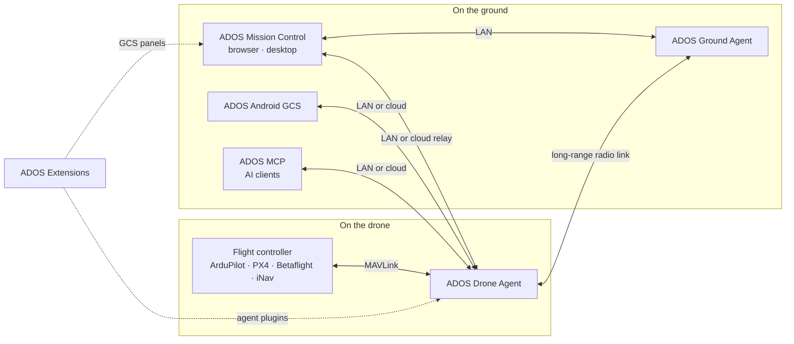

<p align="center">
  <a href="https://altnautica.com">
    <picture>
      <source media="(prefers-color-scheme: dark)" srcset=".github/assets/brand/ados-lockup-dark.svg">
      
    </picture>
  </a>
</p>
<h1 align="center">ADOS Documentation</h1>
<p align="center"><em>Guides, references and runbooks for every ADOS product, in the open alongside the code.</em></p>
<p align="center"><a href="https://creativecommons.org/publicdomain/zero/1.0/"></a> <a href="https://mintlify.com"></a> <a href="https://discord.gg/uxbvuD4d5q"></a></p>
<p align="center">
  <strong><a href="https://github.com/altnautica/ADOSMissionControl">Mission Control</a></strong> |
  <strong><a href="https://github.com/altnautica/ADOSDroneAgent">Drone Agent</a></strong> |
  <strong><a href="https://github.com/altnautica/ADOSAndroidGCS">Android GCS</a></strong> |
  <strong><a href="https://github.com/altnautica/ADOSExtensions">Extensions</a></strong> |
  <strong><a href="https://github.com/altnautica/ADOS-MCP">MCP</a></strong> |
  <strong><a href="https://github.com/altnautica/ADOSDroneAgent/tree/main/crates#published-crates">Rust crates</a></strong> |
  <strong><a href="https://docs.altnautica.com">Docs</a></strong> |
  <strong><a href="https://altnautica.com">Website</a></strong> |
  <strong><a href="https://discord.gg/uxbvuD4d5q">Discord</a></strong>
</p>
<p align="center"><a href="https://docs.altnautica.com">Live docs</a> · <a href="#contributing-to-these-docs">Contributing</a></p>

<picture>
  <source media="(prefers-color-scheme: dark)" srcset=".github/assets/scenes/system-dark.webp">
  
</picture>

This repository is the source of [docs.altnautica.com](https://docs.altnautica.com), the documentation for the ADOS open-source drone platform. It is built with [Mintlify](https://mintlify.com).

## How ADOS fits together



ADOS Ground Agent is the Drone Agent running its ground-station profile.

<!-- ados-family:repos -->
| Repo | Runs on | What it does | Link |
|---|---|---|---|
| ADOS Mission Control | Browser, desktop (Electron) | Ground control station: FC setup, mission planning, flight, 3D simulation, fleet | [ADOSMissionControl](https://github.com/altnautica/ADOSMissionControl) |
| ADOS Drone Agent | Companion computer on the drone, or a ground node | Onboard agent: MAVLink routing, HD video, long-range radio link, plugins, remote control | [ADOSDroneAgent](https://github.com/altnautica/ADOSDroneAgent) |
| ADOS Android GCS | Android phones and tablets | Native ground control app for agents on the LAN, direct flight controllers and the cloud | [ADOSAndroidGCS](https://github.com/altnautica/ADOSAndroidGCS) |
| ADOS Extensions | Drone Agent and Mission Control | First-party signed plugins, each with an agent half and a GCS half | [ADOSExtensions](https://github.com/altnautica/ADOSExtensions) |
| ADOS MCP | Your machine | Model Context Protocol server that lets AI clients operate ADOS drones under scopes and a safety gate | [ADOS-MCP](https://github.com/altnautica/ADOS-MCP) |
| Documentation | docs.altnautica.com | Public docs for every ADOS product | [Documentation](https://github.com/altnautica/Documentation) |
<!-- /ados-family:repos -->

### ADOS Rust crates

Reusable libraries from the ADOS Drone Agent, published on crates.io. Versioning and licences: [crates index](https://github.com/altnautica/ADOSDroneAgent/tree/main/crates#published-crates).

<!-- ados-family:crates -->
**Platform (versioned with the ADOS Drone Agent)**

| Crate | What it does | Docs |
|---|---|---|
| [`ados-protocol`](https://crates.io/crates/ados-protocol) | Wire contracts of the ADOS Drone Agent: IPC framing, plugin RPC envelope, capability tokens and the vision frame bus. | [docs.rs](https://docs.rs/ados-protocol) |
| [`ados-sdk`](https://crates.io/crates/ados-sdk) | Write Rust plugins for the ADOS Drone Agent: IPC client, plugin context, driver traits and lifecycle runner. | [docs.rs](https://docs.rs/ados-sdk) |
| [`ados-vision`](https://crates.io/crates/ados-vision) | Single-object visual tracker: Kalman motion model, appearance re-identification and YOLOv8 head decoding. | [docs.rs](https://docs.rs/ados-vision) |
| [`ados-gpio`](https://crates.io/crates/ados-gpio) | Drive status buzzers and LEDs on Linux GPIO lines, with bounded software-PWM beep patterns. | [docs.rs](https://docs.rs/ados-gpio) |
| [`ados-hal-probe`](https://crates.io/crates/ados-hal-probe) | Find out what a board's hardware can really do by probing it, plus bundled board profiles. | [docs.rs](https://docs.rs/ados-hal-probe) |

**Standalone**

| Crate | What it does | Docs |
|---|---|---|
| [`ados-sensorhub`](https://crates.io/crates/ados-sensorhub) | Sensor hub wire protocol: COBS framing, CRC-16 and fixed-layout IMU, baro, mag and GNSS packets. no_std. | [docs.rs](https://docs.rs/ados-sensorhub) |
| [`ados-offload`](https://crates.io/crates/ados-offload) | Choose where perception runs (onboard, offloaded or hybrid) and hold the vehicle when results go stale. | [docs.rs](https://docs.rs/ados-offload) |
| [`ados-macpin`](https://crates.io/crates/ados-macpin) | Stable MAC addresses for Linux network adapters that randomize theirs every boot. | [docs.rs](https://docs.rs/ados-macpin) |
| [`ados-lora`](https://crates.io/crates/ados-lora) | LoRa transmit governor with cited regional band plans, duty cycle, dwell time and airtime accounting. | [docs.rs](https://docs.rs/ados-lora) |
| [`ados-crsf-codec`](https://crates.io/crates/ados-crsf-codec) | no_std CRSF / ExpressLRS codec for RC channels, telemetry and parameter frames. | [docs.rs](https://docs.rs/ados-crsf-codec) |
| [`ados-positioning`](https://crates.io/crates/ados-positioning) | Split mixed UBX, NMEA and RTCM3 GNSS streams, configure u-blox receivers and run an RTK base survey-in. | [docs.rs](https://docs.rs/ados-positioning) |
| [`ados-rtcm`](https://crates.io/crates/ados-rtcm) | RTCM3 framing, CRC-24Q and MAVLink GPS_RTCM_DATA fragmentation for RTK corrections. | [docs.rs](https://docs.rs/ados-rtcm) |
| [`ados-clock`](https://crates.io/crates/ados-clock) | Map remote clocks onto the host clock: least-squares and envelope fits, TIMESYNC and a chrony sink. | [docs.rs](https://docs.rs/ados-clock) |
| [`ados-swarm`](https://crates.io/crates/ados-swarm) | Swarm control laws: separation, flocking, formations, CBBA task allocation and a point-mass simulator. | [docs.rs](https://docs.rs/ados-swarm) |
| [`ados-mavlink-tunnel`](https://crates.io/crates/ados-mavlink-tunnel) | Send large messages over MAVLink TUNNEL frames with chunking and bounded reassembly. | [docs.rs](https://docs.rs/ados-mavlink-tunnel) |
| [`ados-display-driver`](https://crates.io/crates/ados-display-driver) | Small-display output on Linux: SSD1306/SH1106 OLED over I2C, pixel packers and a framebuffer writer. | [docs.rs](https://docs.rs/ados-display-driver) |
| [`ados-hmi`](https://crates.io/crates/ados-hmi) | Front-panel input: touchscreen calibration and gestures, button presses and rotary encoders. | [docs.rs](https://docs.rs/ados-hmi) |
<!-- /ados-family:crates -->

## Local development

Install the [Mintlify CLI](https://www.npmjs.com/package/mint):

```bash
npm i -g mint
```

Run the docs locally:

```bash
mint dev
```

## Contributing to these docs

Found an error or want to improve a page? Open a pull request.

- Run `mint dev` and check the page renders before you open the pull request.
- A new page needs its MDX file and a `docs.json` navigation entry in the same change. A removed or renamed page needs a `redirects` entry in `docs.json`.
- Files under `snippets/generated/` are generated from the code repositories by `scripts/gen-reference.mjs`. Change the source, never the snippet.
- Follow the writing rules in [AGENTS.md](AGENTS.md).

Contributing to the ADOS code itself is covered in the [contributing guide](https://docs.altnautica.com/getting-started/contributing).

## License

Documentation content is dedicated to the public domain under [CC0 1.0 Universal](https://creativecommons.org/publicdomain/zero/1.0/).
The ADOS software it documents is licensed under [GPLv3](https://www.gnu.org/licenses/gpl-3.0.en.html); the Rust library crates are MIT OR Apache-2.0.
