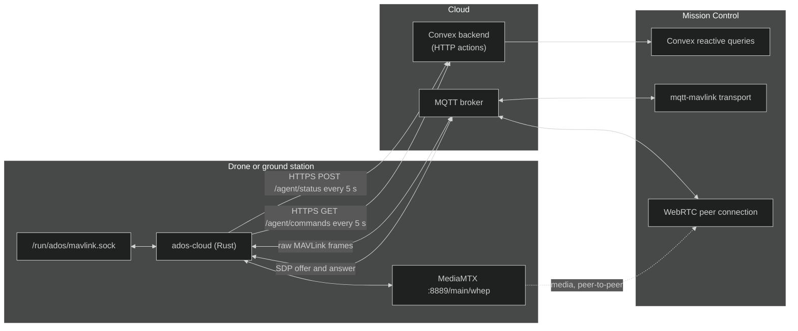

The cloud is optional. Every core ADOS function works without internet. When you want to monitor or fly a node from outside its network, the agent's `ados-cloud` service connects it to two cloud components: a Convex backend and an MQTT broker.

This page explains how those paths work. To run the cloud side yourself, see [Self-hosting overview](/developers/self-hosting/overview). To turn the relay on for a node, see [Cloud relay](/drone-agent/cloud-relay).

## Three paths

### Status and commands over HTTPS

Every 5 seconds, while the node is paired, `ados-cloud` POSTs a JSON status document to the Convex HTTP action `/agent/status`, authenticated with the node's `X-ADOS-Key`. The document carries the node's identity, version and board, plus resource use, flight controller link state and service health. Convex stores the latest document per node in the `cmd_droneStatus` table, and Mission Control reads it through reactive queries, so a change appears in the browser as soon as it lands.

Commands go the other way through the `cmd_droneCommands` table. Mission Control enqueues a command; the node polls `GET /agent/commands` every 5 seconds, runs what it finds and acknowledges each one with `POST /agent/commands/ack`.

This path needs only outbound HTTPS. No inbound ports and no broker.

### MAVLink over MQTT

For live telemetry and control, `ados-cloud` relays raw MAVLink frames between the node's `/run/ados/mavlink.sock` and the broker:

- Frames from the flight controller are published to `ados/{deviceId}/mavlink/tx`.
- Frames the browser publishes to `ados/{deviceId}/mavlink/rx` are written back toward the flight controller.

Nothing is converted to JSON. Mission Control's `mqtt-mavlink` transport feeds the payloads to the same MAVLink parser it uses on a LAN link, so the telemetry rate is whatever rate the flight controller streams. Betaflight and iNav flight controllers use the `msp/tx` and `msp/rx` topics the same way.

The relay never lets a slow uplink stall the flight controller link. Frames wait in a bounded queue (2000 frames) that drops the oldest frame when full, and are sent in batches of up to 50 ms or 4096 bytes. After an outage the newest telemetry goes out first.

### WebRTC signaling over MQTT

Live video does not pass through a cloud media server. The browser and the node set up a WebRTC peer connection, and the broker only relays the SDP:

1. The browser publishes `{"sessionId", "sdp"}` to `ados/{deviceId}/webrtc/offer`.
2. `ados-cloud` posts the SDP to the node's local WHEP endpoint, `http://localhost:8889/main/whep`.
3. It publishes MediaMTX's answer to `ados/{deviceId}/webrtc/answer/{sessionId}`, or an error document so the browser fails fast.
4. Media flows peer-to-peer after ICE completes.
5. The browser ends the session with `{"sessionId", "close": true}`. It also registers that close message as its MQTT last will, so a viewer that disappears is cleaned up when the broker notices.

<Note>
Peer-to-peer WebRTC needs both sides to reach each other after STUN-negotiated NAT traversal. Behind symmetric NAT, which some cellular carriers use, ICE negotiation can fail. Mission Control's transport switcher reports the stage that failed. The video modes are described on [Video stack](/architecture/video-stack#video-transport-modes).
</Note>

## MQTT topics

This is the complete set of topics a node uses. `{deviceId}` is the node's device id.

| Topic | Direction | QoS | Carries |
|-------|-----------|-----|---------|
| `ados/{deviceId}/mavlink/tx` | Node to browser | 0 | Raw MAVLink frames from the flight controller, batched |
| `ados/{deviceId}/mavlink/rx` | Browser to node | 0 | Raw MAVLink frames for the flight controller |
| `ados/{deviceId}/msp/tx` | Node to browser | 0 | Raw MSP bytes from a Betaflight or iNav flight controller |
| `ados/{deviceId}/msp/rx` | Browser to node | 0 | Raw MSP bytes for the flight controller |
| `ados/{deviceId}/webrtc/offer` | Browser to node | 1 | JSON envelope: `{"sessionId", "sdp"}` to open, `{"sessionId", "close": true}` to end |
| `ados/{deviceId}/webrtc/answer/{sessionId}` | Node to browser | 1 | The SDP answer for one session, or an error document |
| `ados/{deviceId}/vision/detections` | Node to browser | 0 | Live vision detection batches, in the same shape as the LAN detection stream |
| `ados/{deviceId}/plugin/update_available` | Node to browser | 1 | A plugin update the daily check will not apply on its own (major version, permission change, board dropped, or pinned) |
| `ados/{deviceId}/plugin/{pluginId}/{stream}` | Node to browser | 0 | A plugin's own live stream, which the plugin host hands to `ados-cloud` to publish |

## Broker connection

Which broker the node dials depends on `server.mode` in `/etc/ados/config.yaml`:

| `server.mode` | Broker |
|---------------|--------|
| `local` (default) | None. The node stays local-first and sends nothing to the cloud |
| `cloud` | The managed broker on port 443, MQTT over a TLS WebSocket at path `/mqtt` |
| `self_hosted` | Your broker, from `server.self_hosted.mqtt_broker` and `server.self_hosted.mqtt_port` (default 8883). With no broker set, the node has no relay; it never falls back to the managed broker |

`server.mqtt_transport` picks the wire: `websockets` (the default) is MQTT over a TLS WebSocket, and `tcp` is MQTT over TLS on the configured port. Over WebSockets, a configured port of 8883 is dialed as 443.

Every relay lane authenticates to the broker as `ados-{deviceId}`. Each lane also has its own client ID (`ados-{deviceId}` for MAVLink, with `-msp`, `-webrtc`, `-plugin-update` and `-plugin-publish` suffixes for the others), because a broker disconnects an existing session when a second client presents the same ID.

The full `server` key reference is on [Configuration](/drone-agent/configuration).

## Ground stations

A ground station runs the same `ados-cloud` service. When its uplink router reports an active uplink, it relays the MAVLink it receives from the drone over the radio on to the broker and sends its own status heartbeat, so a drone with no internet connection of its own can still be watched remotely. It reacts to uplink changes and data-cap limits from the uplink router.

## Next steps

<CardGroup cols={2}>
  <Card title="Cloud relay" icon="tower-broadcast" href="/drone-agent/cloud-relay">
    Turn on the cloud relay for a node.
  </Card>
  <Card title="Self-hosting overview" icon="server" href="/developers/self-hosting/overview">
    Run Convex, the broker and the video relay yourself.
  </Card>
  <Card title="Video stack" icon="video" href="/architecture/video-stack">
    Where WebRTC fits in the camera-to-browser path.
  </Card>
</CardGroup>
