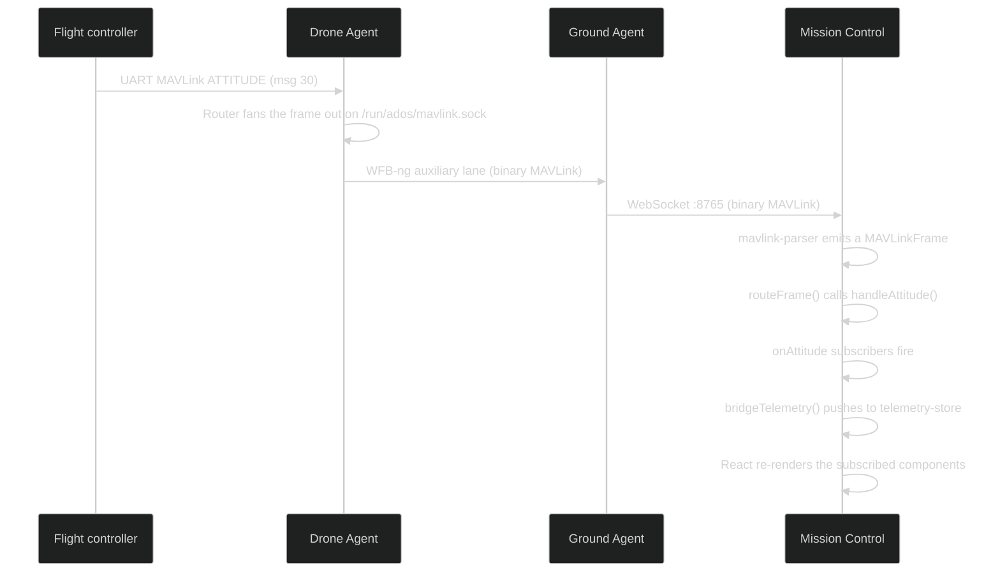

Mission Control talks to flight controllers in MAVLink v2 (ArduPilot and PX4) and MSP (Betaflight and iNav). One TypeScript interface, `DroneProtocol`, hides the difference so the rest of the app does not care which firmware is on the other end.

## MAVLink v2 framing

MAVLink v2 is a binary protocol. Every frame has the same layout:

```text
| STX (0xFD) | LEN | INC_FLAGS | CMP_FLAGS | SEQ | SYSID | COMPID | MSGID (3 bytes) | PAYLOAD | CRC (2 bytes) | SIGNATURE (13 bytes, optional) |
```

- **STX** is `0xFD` for v2.
- **LEN** is the payload length. v2 trims trailing zero bytes from the payload, so the receiver restores the full length before decoding.
- **MSGID** is 3 bytes.
- **CRC** is CRC-16/MCRF4XX over the frame, seeded with a per-message **CRC_EXTRA** byte.
- **SIGNATURE** is present when bit 0 of `INC_FLAGS` is set: link id, a 48-bit timestamp and a 6-byte signature. `src/lib/protocol/mavlink-signer.ts` builds and checks it.

### CRC_EXTRA

Every MAVLink message definition has a CRC_EXTRA constant derived from its field layout. If the sender and the receiver disagree on a message's layout, the CRC fails and the frame is dropped. Mission Control keeps the CRC_EXTRA value and the full payload length for every message it decodes in `src/lib/protocol/mavlink-crc-extra.ts` (`CRC_EXTRA` and `PAYLOAD_LENGTHS`).

## Parser

`src/lib/protocol/mavlink-parser.ts` is a streaming parser. It accumulates bytes from the transport in whatever chunks they arrive, scans for `0xFD`, reads the header and payload, restores zero-trimmed payloads, checks the CRC and emits a typed `MAVLinkFrame`.

```text
bytes in -> find 0xFD -> read header -> read payload -> restore trimmed bytes -> check CRC -> emit frame
```

## The DroneProtocol interface

`DroneProtocol` is defined in `src/lib/protocol/types/protocol.ts`. Every adapter implements it: `MAVLinkAdapter`, `MSPAdapter`, and the demo-mode `MockProtocol`. Its methods fall into groups:

```typescript
interface DroneProtocol {
  readonly protocolName: string;

  // Connection
  connect(transport: Transport): Promise<VehicleInfo>;
  disconnect(): Promise<void>;

  // Commands
  arm(): Promise<CommandResult>;
  disarm(): Promise<CommandResult>;
  setFlightMode(mode: UnifiedFlightMode): Promise<CommandResult>;
  takeoff(altitude: number): Promise<CommandResult>;
  returnToLaunch(): Promise<CommandResult>;
  commitParamsToFlash(): Promise<CommandResult>;

  // Parameters
  getAllParameters(): Promise<ParameterValue[]>;
  getParameter(name: string): Promise<ParameterValue>;
  setParameter(name: string, value: number): Promise<CommandResult>;

  // Telemetry subscriptions, each returning an unsubscribe function
  onAttitude(callback: AttitudeCallback): () => void;
  onPosition(callback: PositionCallback): () => void;
  onBattery(callback: BatteryCallback): () => void;
  onGps(callback: GpsCallback): () => void;
  onHeartbeat(callback: HeartbeatCallback): () => void;

  // What this firmware supports
  getCapabilities(): ProtocolCapabilities;
}
```

The real interface has many more members, including optional ones (marked `?`) that only some firmwares implement, such as iNav safehomes and geozones or fence and rally upload.

`ProtocolCapabilities` (in `src/lib/protocol/types/core.ts`) is a set of booleans such as `supportsParameters`, `supportsMissionUpload`, `supportsCalibration`, `supportsFailsafe`, `supportsOsd` and `supportsFirmwareFlash`. The UI reads it before showing a feature. A flight controller configuration panel that depends on one names it as its `requiredCapability`, so the panel does not appear for a firmware that lacks it.

## MAVLink adapter

`MAVLinkAdapter` (`src/lib/protocol/mavlink-adapter.ts`) implements `DroneProtocol` for ArduPilot and PX4. Its work is split across sibling files:

| File | Role |
|------|------|
| `mavlink-adapter-frame-handlers.ts` | `routeFrame()`: the switch from message id to handler, plus the stateful parameter, mission and version exchanges |
| `handlers/*.ts` | Stateless decoders grouped by area (telemetry, navigation and safety, calibration, CAN, vision, info, debug) that decode a payload and call the subscribers |
| `messages/*.ts` | The typed `decode*` functions for each message |
| `mavlink-adapter-callbacks.ts` | The subscriber lists behind every `on*` method |
| `mavlink-adapter-commands.ts` | `COMMAND_LONG` and `COMMAND_INT` commands, with acknowledgement tracking |
| `mavlink-adapter-params.ts` | The parameter protocol (`PARAM_REQUEST_LIST`, `PARAM_REQUEST_READ`, `PARAM_SET`, `PARAM_VALUE`) |
| `mavlink-adapter-missions.ts` | The mission protocol (`MISSION_COUNT`, `MISSION_REQUEST_INT`, `MISSION_ITEM_INT`, `MISSION_ACK`) |
| `mavlink-adapter-ftp.ts`, `mavlink-adapter-logs.ts` | MAVLink FTP and onboard log download |

ArduPilot and PX4 share MAVLink but differ in parameter names, mode numbers and some command meanings. The adapter learns the firmware from the heartbeat and from `AUTOPILOT_VERSION`, then applies the matching mode map and parameter metadata.

## MSP adapter

`MSPAdapter` (`src/lib/protocol/msp-adapter.ts`) implements `DroneProtocol` for Betaflight and iNav. MSP is a different kind of protocol:

- Request and response, with one request outstanding at a time. `msp/msp-serial-queue.ts` serializes requests and matches each reply.
- MSPv1 framing with an XOR checksum, and MSPv2 framing with a CRC-8 DVB-S2 checksum. The parser in `msp/msp-parser.ts` also handles jumbo frames.
- No named parameters. Configuration lives in binary blocks (PID profile, rate profile, OSD layout, serial ports and so on).

The adapter delegates to `msp-adapter-telemetry.ts` (polled telemetry), `msp-adapter-commands.ts` (commands) and `msp-adapter-params.ts` (virtual parameters).

### Virtual parameters

Because Betaflight and iNav have no parameter store, the MSP adapter maps fields of the configuration blocks to virtual parameter names such as `BF_RC_RATE`, `BF_RC_EXPO` and `BF_ROLL_RATE`. The definitions live in `src/lib/protocol/msp/virtual-params/`. This lets the `usePanelParams` hook, which every configuration panel uses, read and write Betaflight settings the same way it handles MAVLink parameters.

## Encoders

MAVLink encoding lives in `src/lib/protocol/encoders/`. `index.ts` re-exports every module, and `src/lib/protocol/mavlink-encoder.ts` re-exports the barrel.

| Module | Encodes |
|--------|---------|
| `frame.ts` | The v2 frame itself: header, sequence numbers and the CRC with CRC_EXTRA |
| `core.ts` | `HEARTBEAT`, `COMMAND_LONG`, `COMMAND_INT`, `SET_MODE`, `REQUEST_DATA_STREAM`, `SET_GPS_GLOBAL_ORIGIN` |
| `params.ts` | `PARAM_REQUEST_LIST`, `PARAM_REQUEST_READ`, `PARAM_SET` |
| `control.ts` | `MANUAL_CONTROL` stick input |
| `mission.ts` | `MISSION_COUNT`, `MISSION_ITEM_INT`, `MISSION_REQUEST_LIST`, `MISSION_REQUEST_INT`, `MISSION_ACK`, `MISSION_CLEAR_ALL` |
| `peripheral.ts` | `SERIAL_CONTROL` and the onboard log requests (`LOG_REQUEST_LIST`, `LOG_REQUEST_DATA`, `LOG_ERASE`, `LOG_REQUEST_END`) |
| `ekf-source.ts` | EKF source-set selection |
| `can-forward.ts` | CAN forwarding, `CAN_FRAME`, `CANFD_FRAME` and `CAN_FILTER_MODIFY` |
| `ftp.ts` | `FILE_TRANSFER_PROTOCOL`: the 12-byte FTP header and data inside the MAVLink payload |
| `bounds.ts` | Range-checked integer writes, so an out-of-range value raises an error instead of wrapping into a different, valid-looking value on the wire |

## Transports

The adapters do not care how bytes arrive. Each transport implements the `Transport` interface in `src/lib/protocol/types/transport.ts`; the implementations are in `src/lib/protocol/transport/`.

| Transport | File | Use |
|-----------|------|-----|
| WebSocket | `websocket.ts` | The agent's MAVLink WebSocket on `:8765` (HMAC ticket), a local MAVLink router, or the SITL bridge in `tools/sitl/` |
| Web Serial | `webserial.ts` | A flight controller on USB, straight from the browser |
| UDP and TCP | `net-mavlink.ts` | Classic UDP or TCP MAVLink links. The desktop app opens native sockets; in a browser the bytes go through a small local bridge over WebSocket |
| Bluetooth | `ble.ts` | Web Bluetooth to flight controllers with a Nordic UART Service module |
| MQTT (cloud) | `mqtt-mavlink.ts` | Raw MAVLink or MSP frames relayed through the cloud broker on `ados/{id}/mavlink/tx` and `/rx` (or the `msp` lane) when the node is not on your network |
| CAN | `slcan.ts`, `can-transport.ts`, `mavlink-can-forward-transport.ts` | DroneCAN, either over SLCAN on the flight controller's USB port or tunnelled through MAVLink `CAN_FORWARD` |

Demo mode does not use a transport to a real device. `MockProtocol` implements `DroneProtocol` directly and feeds the same stores a real connection would. The demo fleet is described on [Dashboard](/mission-control/dashboard).

## The agent-side router

On a node, MAVLink does not go from the flight controller to the browser directly. The agent's native router (`ados-mavlink-router`, run by the `ados-mavlink` unit) owns the flight controller's serial link, fans frames out on `/run/ados/mavlink.sock` for other agent services, and serves the stream to Mission Control over the WebSocket on `:8765`. A client needs a short-lived HMAC ticket before the router bridges it to the flight controller. See [MAVLink proxy](/drone-agent/mavlink-proxy).

## Message flow example



## Next steps

<CardGroup cols={2}>
  <Card title="State management" icon="database" href="/architecture/state-management">
    How decoded telemetry reaches the stores and the UI.
  </Card>
  <Card title="Code recipes" icon="code-pull-request" href="/architecture/contributing-guide">
    Add a MAVLink decoder or a configuration panel step by step.
  </Card>
</CardGroup>
