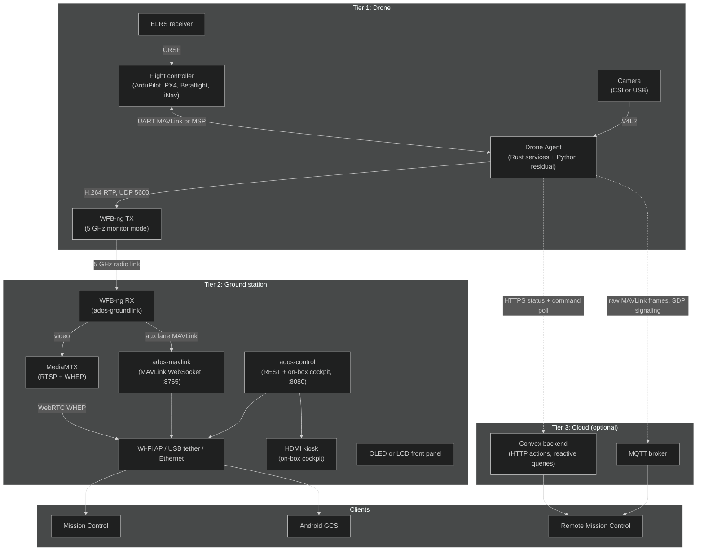

ADOS has three tiers: the Drone Agent on the aircraft, a Ground Agent on a nearby single-board computer, and optional cloud services for remote access. Each tier works on its own. You can fly with the first two and no internet at all.

The Drone Agent and the Ground Agent are the same software. The installer's `--profile` choice (`drone` or `ground_station`) decides which services run. See [Node profiles](/getting-started/node-profiles).

## The three tiers

On the ground station the HDMI kiosk opens the on-box cockpit at `/cockpit/` on port 8080. The front panel shows link and node status on the attached OLED or LCD.

## Deployment models

### Field mode (tiers 1 and 2)

The drone and ground station talk directly over the WFB-ng radio. No internet and no cloud. This is the default for field operations and the shortest path ADOS has. The measured latency figures, and what they cover, are on [Video stack](/architecture/video-stack#what-is-measured-and-what-is-not).

### Cloud mode (tiers 1 and 3)

The drone has its own internet uplink (for example a 4G modem) and reaches the cloud directly. A remote operator opens Mission Control in a browser and gets raw MAVLink over MQTT and video over WebRTC. The carrier network and the broker add to the path, so this is the slowest of the three. There is no WFB-ng link in this model.

### Hybrid mode (tiers 1, 2 and 3)

The ground station receives WFB-ng for local flight and, when it has an uplink, relays the drone's MAVLink and video signaling on to the cloud for remote viewers. The ground station's `ados-cloud` service carries that relay; there is no separate relay unit.

### Distributed receive (several tier 2 nodes)

When one ground station cannot see the whole flight area, two or three Ground Agents can work together. They form a small private mesh over batman-adv on a second USB Wi-Fi adapter. One node takes the `receiver` role; every other node is a `relay` that forwards the WFB-ng fragments it heard. The receiver combines the merged stream with WFB-ng's FEC and serves the video through the same downstream path a single node uses. See [Mesh overview](/ground-agent/mesh-overview).

## Protocol stack

| Connection | Transport | Format |
|------------|-----------|--------|
| Flight controller to agent | UART | MAVLink v2, or MSP for Betaflight and iNav |
| Agent IPC (MAVLink) | Unix socket `/run/ados/mavlink.sock` | 4-byte big-endian length, then one MAVLink frame |
| Agent IPC (vehicle state) | Unix socket `/run/ados/state.sock` | 4-byte big-endian length, then a msgpack body, about 10 Hz. See [Agent services](/architecture/agent-services#vehicle-state-socket) |
| Encoder to radio | RTP (RFC 6184) on UDP 5600 | H.264 |
| Air to ground, video | WFB-ng radio port 0 | FEC-encoded H.264 RTP |
| Air to ground, telemetry | WFB-ng auxiliary lane (radio ports 2 and 3, UDP 5602/5603) | Multiplexed MAVLink, node status and identity |
| Air to ground, hop control | WFB-ng radio port 1 (UDP 5803/5810) | Frequency-hop announce, presence beacon, hop acknowledge |
| Ground to browser, video | WebRTC WHEP at `:8080/whep` (`ados-control`, relayed to MediaMTX on loopback) | H.264 RTP |
| Ground to browser, telemetry | WebSocket on `:8765` (short-lived HMAC ticket) | Binary MAVLink |
| Client to agent, control | HTTP REST on `:8080` (`ados-control`) | JSON |
| Agent log and telemetry query | HTTP on `:8090` and a Unix socket (`ados-logd`, off by default) | JSON |
| Agent to cloud, status | HTTPS POST `/agent/status` every 5 s | JSON |
| Agent to cloud, commands | HTTPS GET `/agent/commands` every 5 s | JSON |
| Agent to cloud, telemetry | MQTT `ados/{deviceId}/mavlink/tx` and `/rx` | Raw MAVLink frames, batched |
| Agent to cloud, video | WebRTC, SDP relayed over MQTT | H.264 RTP |

The MQTT topics are listed on [Cloud infrastructure](/architecture/cloud-infrastructure#mqtt-topics).

## Repositories

| Repository | What it holds | Licence |
|------------|---------------|---------|
| [ADOSMissionControl](https://github.com/altnautica/ADOSMissionControl) | Mission Control: the web and desktop ground control station, its Convex backend and the self-host tools | GPLv3 |
| [ADOSDroneAgent](https://github.com/altnautica/ADOSDroneAgent) | The Drone Agent and Ground Agent (one codebase, selected by profile), the installer and the plugin SDKs | GPLv3 |
| [ADOSExtensions](https://github.com/altnautica/ADOSExtensions) | First-party Extensions and the plugin authoring packages | GPLv3 |
| [ADOS-MCP](https://github.com/altnautica/ADOS-MCP) | The MCP server that lets AI assistants read and command ADOS nodes | MIT |
| [ADOSAndroidGCS](https://github.com/altnautica/ADOSAndroidGCS) | The Android GCS app | GPLv3 |
| [Documentation](https://github.com/altnautica/Documentation) | This documentation site | CC0 1.0 |

Directory layouts for each repository are on [Project structure](/architecture/project-structure).

## Key design decisions

**Multi-process over single-process.** Each agent function runs as its own systemd unit with its own cgroup limits. A crashed video encoder does not take down the MAVLink router. See [Agent services](/architecture/agent-services).

**Rust for the long-running services.** The supervisor, MAVLink router, HTTP front, cloud relay, video pipeline, radio and ground receiver are native Rust binaries. Python remains for the residual API, setup, HAL board detection and AI sidecars.

**Web first for the operator.** Mission Control runs in a browser: WebSerial and WebSocket for the flight controller, WebRTC for video, the Gamepad API for sticks. An Electron build adds native UDP and TCP links on the desktop. See [State management](/architecture/state-management).

**WFB-ng for the air link.** The radio runs in monitor mode and broadcasts FEC-encoded packets. There is no association, no handshake and no retransmission, so nothing waits on a lost packet. See [Video stack](/architecture/video-stack).

**Profile over fork.** The ground station is the same agent with a different profile. One installer, one upgrade path and one test matrix.

## Next steps

<CardGroup cols={2}>
  <Card title="Agent services" icon="server" href="/architecture/agent-services">
    The supervisor, the IPC sockets and the HTTP front.
  </Card>
  <Card title="MAVLink protocol" icon="code" href="/architecture/mavlink-protocol">
    How Mission Control parses and sends MAVLink and MSP.
  </Card>
  <Card title="Video stack" icon="video" href="/architecture/video-stack">
    Camera to browser, hop by hop, with the measured latency.
  </Card>
  <Card title="Cloud infrastructure" icon="cloud" href="/architecture/cloud-infrastructure">
    Convex status, MQTT relay and WebRTC signaling.
  </Card>
</CardGroup>
