The video pipeline takes a camera feed, encodes it to H.264 (or H.265), serves it through a local MediaMTX, and transmits it over WFB-ng for long-range video or hands it to the cloud relay for remote viewing.

The pipeline runs as the `ados-video` systemd service (a native Rust binary) on the drone profile.

## Pipeline flow

```mermaid
graph LR
    A[Camera] --> B[Encoder]
    B -->|tee branch A| C[MediaMTX RTSP :8554]
    B -->|tee branch B| R[RTP on UDP 5600]
    R --> D[wfb_tx]
    C --> E[WebRTC WHEP via :8080/whep]
    C --> H[LL-HLS via :8080/hls]
    C --> F[Cloud relay]

    style A fill:#0A0A0A,stroke:#3A82FF
    style B fill:#0A0A0A,stroke:#3A82FF
    style C fill:#0A0A0A,stroke:#3A82FF
    style R fill:#0A0A0A,stroke:#3A82FF
    style D fill:#0A0A0A,stroke:#3A82FF
    style E fill:#0A0A0A,stroke:#3A82FF
    style H fill:#0A0A0A,stroke:#3A82FF
    style F fill:#0A0A0A,stroke:#3A82FF
```



**Camera** (V4L2 or CSI) feeds the encoder, which encodes H.264 once and writes it to two muxers through a `tee`. Branch A is the RTSP publish into the local **MediaMTX**, which serves WebRTC and HLS through the agent's port 8080 and feeds the cloud relay. Branch B is an **RTP** copy on UDP 5600, which is what `wfb_tx` reads for the radio.

The RTP framing matters. `wfb_tx` needs each datagram to survive loss on its own, and RTP (RFC 6184) gives that: a lost packet costs at most one NAL fragment, where a lost chunk of a raw byte stream corrupts everything up to the next start code. The receiver depayloads against the SDP at `/etc/ados/wfb/video.sdp`.

When radio video goes dark, those are the two things to check on the drone: that something is producing on UDP 5600, and that `/etc/ados/wfb/video.sdp` matches what the encoder is emitting. `ados diag video` does both and names the hop that stopped.

## Camera detection

The camera manager scans for cameras at startup:

1. Checks `/dev/video*` devices (V4L2)
2. Queries each with `v4l2-ctl` for capabilities
3. Filters for actual video capture devices (skips metadata-only nodes)
4. Sorts by priority: CSI first, then USB

If no camera is found, the video service stays in `idle` state and retries on USB hot-plug events.

```yaml
video:
  camera:
    source: "csi"     # csi | usb | ip, or a device path (/dev/video0) or RTSP URL
    codec: "h264"
    width: 1280
    height: 720
    fps: 30
    bitrate_kbps: 4000
```

<Note>
There is no test-pattern source value. To exercise the pipeline with no camera attached, point `source` at an RTSP URL served by a local generator.
</Note>

## Hero and thumbnail profiles

A radio-linked drone boots at 1 fps thumbnail until selected. One fleet shares one WFB channel, so only one aircraft streams full video at a time.

| `video.mode` | Boot profile | Settings |
|---|---|---|
| `wfb` | Thumbnail | `video.camera.thumbnail`: 320x180, 1 fps, 50 kbps by default |
| Anything else (LAN or cloud only) | Hero | The top-level `width`, `height`, `fps` and `bitrate_kbps` |

The ground station or Mission Control promotes one drone to hero with `POST /api/video/profile`, and that drone switches to its full settings. A one-drone fleet is promoted automatically. Only the primary leg is switched. See [Airtime and the thumbnail profile](/drone-agent/multi-camera#airtime-and-the-thumbnail-profile) for the configuration block.

## Encoding

The encoder builds one ffmpeg command line tuned for low latency, with the radio's RTP copy as a second `tee` branch off the same encode:

```bash
ffmpeg -fflags nobuffer -flags low_delay \
  -probesize 32 -analyzeduration 0 \
  -f v4l2 -input_format mjpeg -video_size 1280x720 -framerate 30 \
  -i /dev/video0 \
  -c:v libx264 -b:v 4000k \
  -pix_fmt yuv420p -profile:v high -level:v 4.1 \
  -preset ultrafast -tune zerolatency \
  -g 15 -bf 0 -refs 1 -threads 4 -flush_packets 1 \
  -x264-params no-mbtree=1:sync-lookahead=0:rc-lookahead=0:sliced-threads=1:slices=4:scenecut=0 \
  -bsf:v h264_mp4toannexb,dump_extra=freq=keyframe \
  -max_delay 0 -muxdelay 0 -muxpreload 0 \
  -map 0:v -f tee \
  '[f=rtsp:rtsp_transport=tcp:max_delay=0:flush_packets=1]rtsp://127.0.0.1:8554/main|[f=rtp:payload_type=96:ssrc=0xCAFE:max_delay=0:flush_packets=1]rtp://127.0.0.1:5600?pkt_size=1316'
```

Key encoding flags:

| Flag | Purpose |
|------|---------|
| `-fflags nobuffer` | No input buffering |
| `-flags low_delay` | Minimize encoder latency |
| `-probesize 32 -analyzeduration 0` | Skip format analysis on a source whose format is already known |
| `-preset ultrafast -tune zerolatency` | Fastest encode, no B-frames, no lookahead |
| `-profile:v high -level:v 4.1` | H.264 High Profile for browser compatibility (`avc1.640029`) |
| `-g 15` | GOP is `fps/2`, so an IDR every 500 ms at 30 fps |
| `-threads 4` with `sliced-threads=1:slices=4` | Sliced threading emits each frame whole. Frame threading would hold four frames in flight, about 133 ms of pipeline delay at 30 fps. Boards with fewer than four cores use the two-thread frame-threaded form. |
| `dump_extra=freq=keyframe` | Repeats SPS/PPS in-band before every IDR, so a decoder that loses sync re-bootstraps at the next keyframe |
| `-muxdelay 0 -muxpreload 0` | ffmpeg's defaults here are about 0.7 s plus 0.5 s, in front of every downstream hop |

On boards with hardware encoders the encoder switches automatically based on the board profile's `hw_video_codecs` field: `h264_v4l2m2m` through ffmpeg on the Raspberry Pi (the V4L2 M2M device is trial-probed before use), `mpph264enc` through GStreamer on Rockchip, and `omxh264videoenc` through GStreamer on Allwinner. Each path repeats the parameter sets per IDR with its own mechanism, so the recovery behaviour is the same everywhere. To force a path, set `video.camera.encoder` to `auto` (the default), `omx`, `v4l2m2m` or `software`.

A bitrate change does not respawn the encoder unless it is a large one. The adaptive ladder applies small rung moves in place, and only a change of 25% or more restarts the process, because a respawn is a 1 to 2 second blackout.

### Recovering from a decoder desync

The GOP is the whole mechanism. Parameter sets in-band per IDR plus a 500 ms GOP means a decoder that loses sync re-bootstraps within half a second.

There is no keyframe-on-demand path. The encoders expose no runtime control channel an IDR could be requested through, and MediaMTX does not forward a browser's PLI to an RTSP publisher. The most a request could save is the 0 to 500 ms wait, and forcing an IDR by respawning the encoder costs several times that in blackout.

### H.264 vs H.265

H.264 is the default because it works everywhere. Browser players (MSE and WebRTC) expect it. H.265 saves bandwidth at the same quality, but WebRTC H.265 support in browsers is not consistent, so H.265 is not the default.

```yaml
video:
  camera:
    codec: "h264"   # Change to "h265" for bandwidth savings
```

<Warning>
If you switch to H.265, test your player first. Mission Control's WebRTC client expects `avc1.640029` (H.264). H.265 streams may need a different playback path.
</Warning>

## MediaMTX

MediaMTX is a lightweight RTSP/WebRTC server bundled with the agent. The agent manages its lifecycle: starts it on boot, monitors it and restarts it if it crashes.

How a player reaches the stream:

- **RTSP** at `rtsp://<node>:8554/main` for LAN players (VLC, ffplay, GStreamer) and offload nodes.
- **WHEP** (WebRTC, browsers and other off-box players) at `http://<node>:8080/whep` for the primary leg `main`. A secondary leg is `http://<node>:8080/whep?camera=<id>`. The request carries the pairing key like any other API call.
- **LL-HLS** fallback at `http://<node>:8080/hls/main/index.m3u8`.

MediaMTX's own WebRTC and HLS listeners bind loopback (`127.0.0.1:8889` and `127.0.0.1:8888`) and are not reachable off-box. Media flows on UDP 8189.

The agent writes the whole MediaMTX document itself, from one generator shared by the air and ground profiles:

```yaml
# Managed by the agent, written to /etc/ados/mediamtx.yml
webrtcLocalUDPAddress: ":8189"
webrtcLocalTCPAddress: ""          # LAN profiles offer no TCP ICE candidate
webrtcIPsFromInterfaces: true
webrtcIPsFromInterfacesList: []
webrtcHandshakeTimeout: 10s
webrtcSTUNGatherTimeout: 2s
webrtcICEServers2: []              # LAN profiles gather no STUN
```

UDP ICE is pinned to one port, 8189, so a firewall rule is one line. STUN is configured only on the cloud-relay profile: on a LAN session the browser connects on host candidates, so a STUN entry would be pure handshake latency before the first frame.

The generated paths keep `useAbsoluteTimestamp: false` on both profiles, so a reader gets frames as soon as the encoder publishes. With it on, MediaMTX would drop every packet until the encoder's first RTCP sender report, about 5 s of blank video after each encoder start, camera recovery or hero and thumbnail switch. Frame capture time for latency measurement travels in the wall-clock SEI the agent injects (`video.wfb.sei_latency`), not in RTP timestamps.

### Source recovery

Every recovery path in the pipeline retries on one fixed 2 s tick, with no backoff and no attempt limit: the encoder respawn after its source drops, the cold start from the error state, and the consumers of `main` (cloud push, WFB tap, vision tap, SEI tap, secondary-leg encoders). A camera that comes back is republished on `main` within one tick plus the encoder's spawn and connect time, and every consumer restarts on the same tick.

<Warning>
Do not hand-edit `/etc/ados/mediamtx.yml`. MediaMTX rejects an unrecognised key outright, so a typo does not degrade the node, it leaves the node with no media server at all. Change `video.*` in `/etc/ados/config.yaml` and let the agent regenerate the file.
</Warning>

## Transports

The same encoded stream leaves the drone on these paths:

| Transport | Path | Best for |
|---|---|---|
| WebRTC | WHEP via `:8080/whep`, ICE on UDP 8189 | Browser viewing on the LAN. |
| LL-HLS | `/hls/main/...` via `:8080` | Browsers that cannot open a WebRTC session. The dashboard video card has an HLS/WebRTC toggle. |
| RTSP | Read from `:8554` | LAN players and offload nodes. |
| WFB-ng | RTP (RFC 6184, payload type 96, SSRC `0xCAFE`, `pkt_size` 1316) on UDP 5600, injected by `wfb_tx -u 5600` | Field flight, long range, line of sight. |
| Cloud relay | WebRTC with signaling over MQTT | Off-LAN viewing. See [Cloud relay](/drone-agent/cloud-relay). |

## Recording

Recording is continuous and segmented, handled inside MediaMTX with no extra encode pass:

```yaml
video:
  recording:
    enabled: false          # off by default
    path: "/var/ados/recordings"
    retention: "24h"        # how long segments are kept before deletion
```

Segments land under `/var/ados/recordings/<path>/%Y-%m-%d_%H-%M-%S-%f`, one minute each. There is no whole-file capture and no maximum duration: the segment set on disk **is** the pre-roll ring, so an arbitrary window before any event stays extractable after the fact.

On a drone, start and stop a node-local capture with `POST /api/video/record/start` and `POST /api/video/record/stop`; recorded segments sit under `/var/ados/recordings/main/`. On a ground station, cut a clip with `ados record clip --path <stream> --start <rfc3339> --duration <seconds> -o <file>`.

<Warning>
`retention` is the time bound; the supervisor's storage janitor also deletes the oldest recordings under disk pressure. Size `retention` to your card and bitrate anyway, especially on a node you cannot reach.
</Warning>

## Snapshots

Grab one JPEG from the live feed:

```bash
curl -o snap.jpg -H "X-ADOS-Key: $KEY" http://localhost:8080/api/video/snapshot
```

`GET /api/video/snapshot` returns one JPEG grabbed live from the `main` path, with the capture time in the `X-Captured-At` header. Nothing is written to disk. When no frame is available it answers `503` with `E_NO_FRAME`.

## Pipeline health monitoring

The service checks that bytes keep arriving at MediaMTX's `main` path and that the radio tap keeps making progress (15 s window). It restarts a stalled leg and drops to software x264 after three hardware-encoder failures.

## Video status

From the terminal:

```bash
ados status
```

From the REST API:

```bash
curl http://localhost:8080/api/video \
  -H "X-ADOS-Key: your_key"
```

The response includes camera details, encoder state, MediaMTX status, recording state and the playback URLs.

For a per-hop verdict rather than a summary, `ados diag video` samples the cumulative counters at each hop twice and names the hop that stopped. See [Drone Agent diagnostics](/drone-agent/diagnostics).

## More than one camera

Everything above describes the single `video.camera` block. A node with several cameras declares a `video.cameras` list instead, one entry per video leg, each served as its own MediaMTX path and WHEP leg. See [Multi-camera](/drone-agent/multi-camera).

## Next steps

<CardGroup cols={2}>
<Card title="Multi-camera" icon="camera-rotate" href="/drone-agent/multi-camera">
Declare several legs and choose which one rides the radio.
</Card>
<Card title="WFB-ng" icon="tower-broadcast" href="/drone-agent/wfb-ng">
The long-range radio link that carries the primary leg.
</Card>
<Card title="Video stack" icon="diagram-project" href="/architecture/video-stack">
End-to-end architecture and latency figures.
</Card>
<Card title="Drone Agent diagnostics" icon="stethoscope" href="/drone-agent/diagnostics">
Find the hop where video stopped.
</Card>
</CardGroup>
