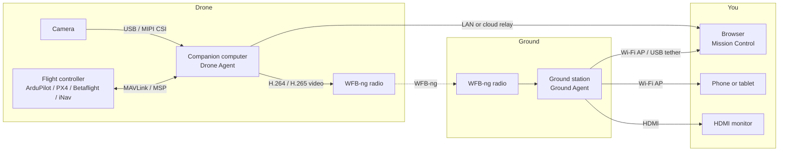

ADOS is an open-source software stack for drones. It covers the aircraft, the ground and the fleet: an agent on the drone's companion computer, the same agent on a ground station for long-range video, a ground control station that runs in your browser, and the extensions, SDKs and AI tooling built on them.

## Pick your path

<CardGroup cols={3}>
  <Card title="Try it now" icon="play" href="/getting-started/quickstart-mission-control">
    Open Mission Control in a browser or the desktop app and fly the demo fleet. No hardware needed.
  </Card>
  <Card title="Fly a flight controller over USB" icon="usb" href="/mission-control/connecting">
    Plug your flight controller into a laptop and use Mission Control on its own to configure, plan and fly.
  </Card>
  <Card title="Add a companion computer or long-range link" icon="tower-broadcast" href="/getting-started/quickstart-drone-agent">
    Install the Drone Agent on the drone first, then add a Ground Agent for long-range WFB-ng video.
  </Card>
</CardGroup>

Not sure which software goes where? See [Choose what to install](/getting-started/install-paths).

## The products

<CardGroup cols={2}>
  <Card title="Mission Control" icon="display" href="/mission-control/overview">
    The ground control station. Configure, plan, simulate and fly from a browser tab or the desktop app. ArduPilot, PX4, Betaflight and iNav.
  </Card>
  <Card title="Drone Agent" icon="microchip" href="/drone-agent/overview">
    Runs on the companion computer aboard the drone. Native Rust services handle the HTTP front, MAVLink routing, video, cloud relay and radio. Python handles vision, hardware detection and the plugin runtime.
  </Card>
  <Card title="Ground Agent" icon="tower-broadcast" href="/ground-agent/overview">
    The same agent installed with the `ground_station` profile. Receives long-range video and serves it to laptops, phones and an HDMI monitor, with an OLED, buttons and an optional touch LCD.
  </Card>
  <Card title="Workstation" icon="server" href="/getting-started/node-profiles#the-four-profiles">
    The agent on a laptop, desktop or GPU box, or headless as a compute node. Runs heavy jobs such as World Engine reconstruction for drones on the same network.
  </Card>
  <Card title="Android GCS" icon="mobile" href="/android/overview">
    A native ground control station for Android 10 and later phones and tablets: live video, flight controls, maps and mission planning.
  </Card>
  <Card title="Extensions" icon="puzzle-piece" href="/drone-agent/extensions-catalog">
    Signed packages that add drivers, cockpit controls and autonomy features without touching the core. Build your own with the Python, Rust or TypeScript SDK.
  </Card>
  <Card title="MCP server" icon="robot" href="/developers/mcp-server">
    Connect AI assistants to your aircraft over the Model Context Protocol, with scoped tokens and permissions you control.
  </Card>
</CardGroup>

## How they fit together

The flight controller runs the autopilot firmware. The companion computer runs the Drone Agent. On the ground, a small single-board computer runs the Ground Agent. Mission Control runs in your browser, the desktop app or the Android GCS.

<Note>
You do not need every product at once. Mission Control works on its own with a USB cable to your flight controller. The Drone Agent works on its own over Wi-Fi, Ethernet or a cellular modem. The Ground Agent is only needed for long-range WFB-ng video.
</Note>

## Who it is for

**FPV builders and pilots.** You already have a drone and want configuration tools, mission planning and a ground control station that runs in your browser.

**Researchers and engineers.** You need a programmable platform with a REST API, SDKs in Python, Rust and TypeScript, and AI access over MCP.

**Operators.** You run mapping, inspection or agriculture missions and need planning, fleet telemetry and room to customise.

**Students and educators.** You want to learn how drones work at every layer, in code you can read.

**Hardware integrators.** You build drone hardware and want an open software stack on it. The agent describes each supported board with a board profile; see [Supported hardware](/drone-agent/supported-hardware).

## What each product does

### Mission Control
- Connects to ArduPilot, PX4, Betaflight or iNav over USB (WebSerial), the LAN or the cloud relay
- Flight controller configuration panels and calibration wizards
- Mission planning with pattern generators, 3D mission simulation, geofences and rally points
- A per-node cockpit with live video, gamepad and HOTAS control
- Firmware flashing from the Flash Tool
- Demo mode with a simulated fleet, so you can try it with no hardware

### Drone Agent
- One-line install on 64-bit ARM (aarch64) Linux boards; x86_64 Linux uses a locally built installer, and macOS installs as a workstation
- Detects the board and the flight controller
- Camera to H.264 or H.265 video over WFB-ng or WebRTC
- A REST API and browser dashboard on port 8080, served by a native Rust front
- A [terminal dashboard](/drone-agent/tui-dashboard) and the `ados` CLI
- Signed extensions with SDKs for Python, Rust and TypeScript
- Updates with `ados update`

### Ground Agent
- Same install script, with `--profile ground_station`
- Receives WFB-ng video and serves it to browsers over WebRTC
- Wi-Fi access point and USB tether for laptops and phones
- Physical controls: OLED and buttons, plus an optional touch LCD
- HDMI kiosk mode for field use with a monitor and gamepad
- Mesh relay and receiver roles (distributed receive) for multi-node ground networks

## Licensing

Mission Control, the Drone Agent (which is also the Ground Agent), the Android GCS and the first-party extensions are licensed under **GPLv3**. The MCP server is **MIT**. This documentation is dedicated to the public domain under **CC0 1.0 Universal**. See [Open source](/getting-started/open-source) for every repository and its licence.

## Next steps

<CardGroup cols={2}>
  <Card title="How ADOS works" icon="gears" href="/getting-started/how-it-works">
    The data paths between the flight controller, the agent and Mission Control.
  </Card>
  <Card title="Quickstart: Mission Control" icon="display" href="/getting-started/quickstart-mission-control">
    Run the ground control station in your browser. No drone needed.
  </Card>
  <Card title="Quickstart: Drone Agent" icon="microchip" href="/getting-started/quickstart-drone-agent">
    Install the agent on a companion computer.
  </Card>
  <Card title="Safety" icon="shield-halved" href="/operations/safety">
    Read this before you arm a real aircraft.
  </Card>
</CardGroup>
