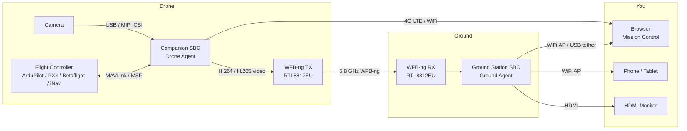

## A software-defined drone platform

Altnautica ADOS is an open-source software stack for drones. It covers the aircraft, the ground and the fleet: software on the drone's companion computer, a ground station node for long-range video, a ground control station that runs in your browser, and the extensions, SDKs and AI tooling that build on them.

You do not need a specific drone. ADOS works with flight controllers running ArduPilot, PX4, Betaflight or iNav. Add a companion computer (a Raspberry Pi, a Radxa board, or another Linux SBC), install the agent, and the drone gains video streaming, a REST API, an extension host, cloud relay and one-command updates.

## The products

<CardGroup cols={2}>
  <Card title="Mission Control" icon="display" href="/mission-control/overview">
    The ground control station. Configure, plan, simulate and fly from a browser tab or the desktop app. ArduPilot, PX4, Betaflight and iNav.
  </Card>
  <Card title="Drone Agent" icon="microchip" href="/drone-agent/overview">
    Runs on the companion computer aboard the drone. Native Rust services handle the REST front, MAVLink routing, video, cloud relay and radio; Python handles vision, hardware bootstrap and the plugin runtime.
  </Card>
  <Card title="Ground Agent" icon="tower-broadcast" href="/getting-started/quickstart-ground-agent">
    The same agent in ground-station mode. Receives long-range video and relays it to laptops, phones and an HDMI monitor, with an OLED, buttons and an optional 480x320 touch LCD.
  </Card>
  <Card title="Workstation" icon="server" href="/getting-started/node-profiles">
    The agent on a laptop, desktop or GPU box, or headless as a compute node. Runs heavy jobs such as World Engine reconstruction for drones on the same network.
  </Card>
  <Card title="Android GCS" icon="mobile" href="/android/overview">
    A native ground control station for Android phones and tablets: live video with a HUD, flight controls and maps. Current release: v0.1.6.
  </Card>
  <Card title="Extensions" icon="puzzle-piece" href="/drone-agent/extensions-catalog">
    Signed packages that add drivers, cockpit controls and autonomy features without touching the core. Build your own with the Python, Rust or TypeScript SDK.
  </Card>
  <Card title="MCP server" icon="robot" href="/developers/mcp-server">
    Connect AI assistants to your aircraft over the Model Context Protocol, with scoped tokens and permissions you control.
  </Card>
</CardGroup>

## How they fit together

The flight controller runs the autopilot firmware. The companion computer runs the Drone Agent. On the ground, a small SBC runs the Ground Agent. Mission Control runs in your browser, the desktop app or on Android.

Link range depends on the antennas: expect 1-3 km line of sight with stock antennas, and more with a high-gain ground dish. See [WFB-ng](/drone-agent/wfb-ng).

<Note>
You do not need every product at once. Mission Control works on its own with a USB cable to your flight controller. The Drone Agent works on its own over WiFi or a 4G modem. The Ground Agent is only needed for long-range WFB-ng video.
</Note>

## Who is this for?

**FPV builders and pilots.** You already have a drone and want strong configuration tools, mission planning and a GCS that runs in your browser.

**Researchers and engineers.** You need a programmable platform with a REST API, SDKs in Python, Rust and TypeScript, and AI access over MCP.

**Commercial operators.** You run mapping, inspection or agriculture missions and need reliable planning, fleet telemetry and room to customise.

**Students and educators.** You want to learn how drones work at every layer. ADOS is open source and documented.

**Hardware integrators.** You build drone hardware and want an open software stack on it. The agent ships 21 board profiles.

## What you can do today

### Mission Control
- Connect to ArduPilot, PX4, Betaflight or iNav over WebSerial (USB in the browser), WiFi or the cloud
- 87 flight controller configuration panels: failsafe, PID tuning, power, OSD, ports, sensors, gimbal, LED, CAN, VTOL and more
- Calibration wizards for accelerometer, gyro, compass, level, RC, ESC, airspeed, barometer and CompassMot
- Mission planning with 9 pattern generators: survey grid, orbit, corridor scan, expanding-square search, sector search, parallel track, structure scan, fixed-wing landing and VTOL landing
- 3D mission simulation, geofence and rally points
- Gamepad and HOTAS flight control, live WebRTC video and a first-person cockpit
- Firmware flashing over WebSerial
- Demo mode with a fourteen-aircraft simulated fleet, so you can try it with no hardware

### Drone Agent
- One-line install on any supported SBC
- Auto-detects the board and the flight controller
- Video pipeline from camera to H.264/H.265 over WFB-ng or WebRTC
- REST API on port 8080, served by a native Rust front
- Setup webapp for onboarding, MAVLink, video, network and remote access
- A live [terminal dashboard](/drone-agent/tui-dashboard) (`ados`) and CLI groups for config, diagnostics, hardware, logs, MCP, network, plugins, profile, radio and recording
- Signed extensions with SDKs for Python, Rust and TypeScript
- 21 board profiles, from Raspberry Pi to Rockchip, Allwinner, Jetson and generic x86_64
- One-command updates with `ados update`

### Ground Agent
- Same install script, auto-detects ground-station hardware
- Receives WFB-ng video and relays it to browsers over WebRTC
- WiFi access point and USB tether (CDC-NCM) for laptops and phones
- Physical UI: OLED display and buttons, plus an optional 480x320 touch LCD
- HDMI kiosk mode for field use with a monitor and gamepad
- MeshNet relay and receiver roles for multi-node ground networks

## Licensing

ADOS software is licensed under **GPLv3**: Mission Control, the Drone and Ground Agent, the Android GCS and the first-party extensions. The MCP server is **MIT**. Hardware designs are dedicated to the public domain under **CC0 1.0 Universal**.

Read more in the [Open Source](/getting-started/open-source) section.

## Next steps

<CardGroup cols={2}>
  <Card title="How it works" icon="gears" href="/getting-started/how-it-works">
    Understand the data flow between the flight controller, agent and GCS.
  </Card>
  <Card title="Quickstart: Mission Control" icon="display" href="/getting-started/quickstart-mission-control">
    Run the GCS in your browser in under 5 minutes. No drone needed.
  </Card>
  <Card title="Quickstart: Drone Agent" icon="microchip" href="/getting-started/quickstart-drone-agent">
    Install the agent on a companion computer.
  </Card>
  <Card title="Your first flight" icon="plane" href="/getting-started/your-first-flight">
    Connect, arm, fly and land. Step by step.
  </Card>
</CardGroup>
