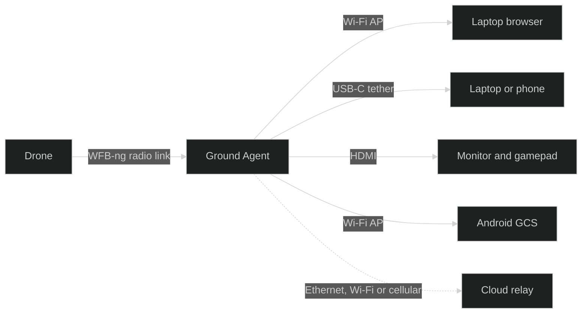

The Ground Agent is a small Linux ground node that receives the drone's long-range radio link and puts video and telemetry on the screens around it: a laptop browser, a phone, an HDMI monitor with a gamepad, or all of them at once.

It is the ADOS Drone Agent running with the `ground_station` profile. Same install script, same code, same updates.

## What it does

1. **Receives the drone link.** The ground node runs the WFB-ng radio receive path, so your laptop or phone never needs radio drivers.
2. **Serves video and telemetry.** WebRTC (WHEP) for video, a MAVLink WebSocket for telemetry, and the agent's own dashboard and cockpit over HTTP.
3. **Bridges to the cloud when you choose to.** The default cloud posture is local only. Once you pick a cloud or self-hosted posture in setup, telemetry flows to the cloud relay over whichever uplink is active (Ethernet, Wi-Fi client or a cellular modem).

## How it fits together

## Ways to connect

Every client reaches the same endpoints on the ground node. Only the physical link differs.

| Client | Connection | Page |
|---|---|---|
| Laptop or phone over Wi-Fi | Join the `ADOS-GS-<id>` access point | [Wi-Fi access point](/ground-agent/wifi-ap) |
| Laptop or phone over a cable | USB-C data cable to the node | [USB tether](/ground-agent/usb-tether) |
| Monitor and gamepad | HDMI monitor and a USB or Bluetooth gamepad on the node | [HDMI kiosk](/ground-agent/hdmi-kiosk) |
| Android phone or tablet | Wi-Fi or USB, browser or the Android GCS app | [Android client](/ground-agent/android-client) |

All of them can connect at the same time. One client at a time holds pilot-in-command (PIC); the others watch.

## Key facts

| Item | Value |
|---|---|
| Profile | `ground_station` |
| Wi-Fi access point | `ADOS-GS-<id>` on 2.4 GHz, `192.168.4.1` |
| USB tether address | `192.168.7.1` |
| Video transport | WebRTC WHEP at `/whep` on port 8080 |
| Telemetry transport | MAVLink WebSocket on port 8765 |
| Dashboard and REST API | Port 8080 |
| Local display | Optional 480x320 SPI touch LCD; optional 128x64 or 128x32 I2C OLED |
| Buttons | Optional four front-panel buttons |
| Power | External USB-C source |
| Licence | GPLv3 |

## One codebase, four profiles

You do not install separate software for the ground side. The agent has four profiles (`drone`, `ground_station`, `workstation` and `compute`), and the profile decides which services run. A ground station is a node installed with `--profile ground_station`. The installer's interactive wizard also offers it as "This receives on the ground (Ground station)".

The installer does not guess from attached hardware. It uses the `--profile` flag, else the profile already recorded in `/etc/ados/profile.conf`, else `drone`. To change the profile of an installed node, run `sudo ados profile set ground_station`, which restarts the affected services itself. See [Install the Ground Agent](/ground-agent/installation) and [Node profiles](/getting-started/node-profiles).

## Three deployment roles

A ground station runs in one of three roles. One node in `direct` mode, the default, covers most setups. When terrain blocks a single receive point, or you want a longer corridor or a backup receiver, two or more ground stations can share the receive job over a local mesh.

- **direct**: single-node receive. The default.
- **relay**: forwards what it hears from the drone to a receiver over the mesh.
- **receiver**: the hub. Combines what it hears with what every paired relay forwards.

[Pick a role](/ground-agent/setup#pick-a-role) compares the three. [Mesh and distributed receive](/ground-agent/mesh-overview) explains when a mesh is worth it.

## Next steps

<CardGroup cols={2}>
  <Card title="Supported hardware" icon="microchip" href="/ground-agent/supported-hardware">
    Boards, radios and the optional front panel.
  </Card>
  <Card title="Power and runtime" icon="battery-full" href="/ground-agent/power-and-runtime">
    Size an external power source.
  </Card>
  <Card title="Install the Ground Agent" icon="download" href="/ground-agent/installation">
    One command on a fresh SBC.
  </Card>
  <Card title="Set up a ground station" icon="list-check" href="/ground-agent/setup">
    Reach the node, pick a role, pair.
  </Card>
</CardGroup>
