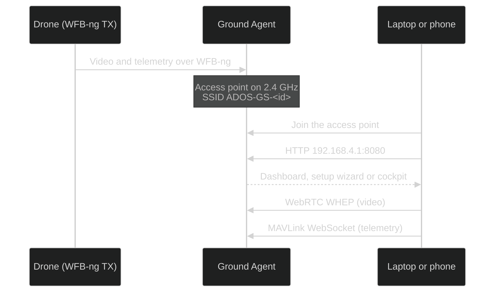

import { GsEndpoints } from "/snippets/gs-endpoints.mdx";

The ground station runs a Wi-Fi access point on its onboard radio. Join it from a laptop or phone and open a browser for video and telemetry. No software to install, no radio drivers, no internet needed.

## How it works



The onboard Wi-Fi radio hosts the access point on 2.4 GHz. The WFB-ng adapter stays on the drone link and is never used for the access point.

## Connect from a laptop

<Steps>
  <Step title="Join the network">
    Look for `ADOS-GS-<id>` in your Wi-Fi list. The suffix comes from the node's device id. The passphrase is generated for that unit; see [The AP passphrase](#the-ap-passphrase).
  </Step>
  <Step title="Open the browser">
    Go to `http://192.168.4.1:8080`. A node that has not finished setup opens the setup wizard; a set-up node opens its dashboard. During first-time setup only, `http://setup.ados.local:8080/` reaches the same page. Mission Control is separate software that runs on your laptop or a server; the ground station does not serve it.
  </Step>
  <Step title="Fly">
    Open the on-box cockpit at `http://192.168.4.1:8080/cockpit/`. It reads a USB or Bluetooth gamepad through the browser's Gamepad API; press any gamepad button to register it.
  </Step>
</Steps>

## Connect from a phone

The flow is the same: join the network, open a browser (Chrome on Android, Safari on iOS) and go to `http://192.168.4.1:8080`.

Android users can also use the Android GCS app. See [Android client](/ground-agent/android-client).

<Note>
Android may show a "No internet" warning after you join. The ground station is a local network, not an internet gateway. Choose "Stay connected" to keep using it.
</Note>

## Network details

| Setting | Value |
|---|---|
| SSID | `ADOS-GS-<id>` |
| Band | 2.4 GHz |
| Default channel | 6 |
| Security | WPA2-PSK |
| Subnet | `192.168.4.0/24` |
| Ground station address | `192.168.4.1` |
| DHCP range | `192.168.4.10` to `192.168.4.100`, 12 h leases |

## Endpoints over Wi-Fi

<GsEndpoints host="192.168.4.1" />

## Several clients

Each video client gets its own WebRTC session. A 2.4 GHz access point carries only a few video viewers before throughput suffers; telemetry over the WebSocket is light.

Only one client at a time holds pilot-in-command (PIC). A gamepad on the HDMI kiosk claims PIC automatically when no one holds it. Other clients claim or release it explicitly from Mission Control or the cockpit.

With **uplink sharing** on, access point and USB clients get NAT internet through the node's active uplink. It does not bridge the access point and USB subnets to each other. See [Uplink matrix](/ground-agent/uplink-matrix#uplink-sharing).

## The AP passphrase

The access point is WPA2-PSK. There is no open mode and no passphrase printed in advance: the agent generates one for each unit the first time the access point starts, so two units flashed from the same image get different passphrases.

The generated value is 12 characters from `ABCDEFGHJKMNPQRSTUVWXYZ23456789`. The alphabet leaves out `0`, `O`, `1`, `I` and `L`, so a passphrase read off a small display does not fail on a character you cannot tell apart. It is stored at `/etc/ados/ap-passphrase`, readable only by root.

### Where to read it

| Surface | What to look for |
|---|---|
| Installer completion summary | A `Wi-Fi access point` section with the network name and passphrase. Write it down here. |
| Terminal status view | The `wifi key` row. Run `ados` on the box or over SSH. |
| LCD | The access point detail page shows the name, the passphrase and a join QR code. |
| `ados network ap-passphrase` | The passphrase on its own line, with no TTY needed, so it composes into a script or pipe. Run it as root. |

The command only reads. On a unit whose access point has never started, it reports that there is no passphrase rather than generating one.

The passphrase is not returned by the REST API and not shown in the browser dashboard. Those surfaces answer anyone who can already reach the ground station, which is exactly the population the access point admits.

### If a passphrase is set in config

`network.hotspot.password` in `/etc/ados/config.yaml` is used when `/etc/ados/ap-passphrase` does not exist. It lets a fleet run one shared credential, which also means every unit built from that config shares one passphrase. Check that key before rolling an image out to several boxes.

<Note>
A factory reset deletes `/etc/ados/ap-passphrase` and the config file, so the unit generates a fresh passphrase on its next start. Anyone holding the old one loses access.
</Note>

## Change the access point

Change the access point from Mission Control (node panel, **Network**) or over REST:

```bash
curl -X PUT http://localhost:8080/api/v1/ground-station/network/ap \
  -H "Content-Type: application/json" \
  -d '{"ssid": "ADOS-GS-FIELD", "passphrase": "correct-horse-battery", "channel": 11, "enabled": true}'
```

| Field | Rule |
|---|---|
| `ssid` | 1 to 32 bytes, no control characters |
| `passphrase` | 8 to 63 printable ASCII characters |
| `channel` | A 2.4 GHz channel, 1 to 13 |
| `enabled` | `true` or `false` |

Omit a field to leave it unchanged. The SSID and channel are also stored as `network.hotspot.ssid` and `network.hotspot.channel` in the config.

<Warning>
If you disable the access point and the node has no other way in (no Ethernet, no USB tether), reconnect over Ethernet or USB tether, or re-enable it from the box with `PUT /api/v1/ground-station/network/ap` and `{"enabled": true}`.
</Warning>

On a node with a single Wi-Fi radio, the access point stands down while that radio carries a working Wi-Fi client uplink, and comes back when the client link drops. See [Uplink matrix](/ground-agent/uplink-matrix#wi-fi-client-and-the-access-point-on-one-radio).

While the access point is enabled and not standing down, the uplink router (`ados-uplink-router`) checks it every 15 seconds and starts it again if it is not running, with no retry limit. A failed start at boot, or an onboard radio that appears late, recovers on its own within one check.

## HTTPS and mixed content

A browser that loaded Mission Control over HTTPS (the hosted version) blocks plain HTTP connections to the ground station. This is browser policy.

1. **Use the on-box surfaces.** `http://192.168.4.1:8080` for the dashboard and `http://192.168.4.1:8080/cockpit/` to fly. Everything stays on the local network.
2. **Run Mission Control locally.** The desktop app, or a local install served over HTTP, can talk to the ground station directly. See [Install Mission Control](/mission-control/installation).

## Next steps

<CardGroup cols={2}>
  <Card title="USB tether" icon="usb" href="/ground-agent/usb-tether">
    The wired alternative.
  </Card>
  <Card title="HDMI kiosk" icon="display" href="/ground-agent/hdmi-kiosk">
    Fly with no laptop at all.
  </Card>
</CardGroup>
